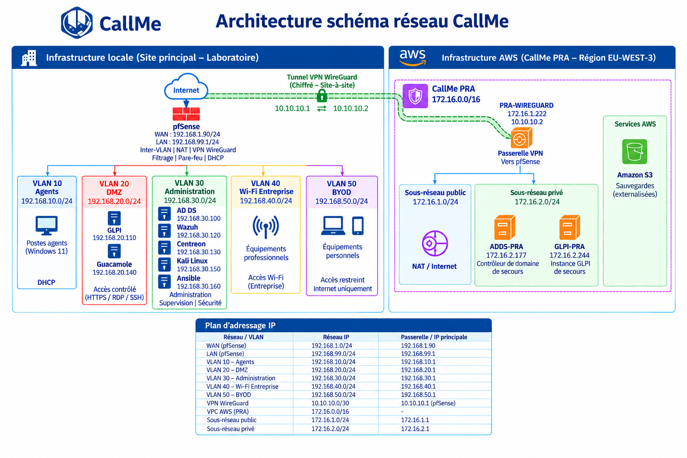

  

<h1 align="center">Infrastructure CallMe</h1>

## Infrastructure hybride, virtualisée et sécurisée d’un centre d’appel

CallMe est un projet de conception et de déploiement d’une infrastructure informatique pour un centre d’appel de 60 collaborateurs.

Le projet couvre les systèmes, les réseaux, la virtualisation, la cybersécurité, la supervision, l’automatisation, le cloud et la mise en place d’un PRA dans AWS.

  

## ◆ Contexte du projet

CallMe est un centre d’appel présent sur plusieurs sites en France.

Le projet concerne le site de Narbonne, composé de 45 agents, 10 superviseurs et 5 administrateurs.

Le site de Narbonne a été choisi comme **site pilote pour la mise en place d’une infrastructure hybride**. Celle-ci combine une infrastructure locale virtualisée sous **Proxmox VE** et un environnement **AWS** utilisé pour le plan de reprise d’activité (PRA).

Cette architecture pilote permet de tester et de valider les solutions techniques, la sécurité, la supervision et le PRA avant d’envisager leur déploiement sur les autres sites de CallMe.

L’objectif est de disposer d’une infrastructure sécurisée, segmentée, supervisée et facile à administrer, capable de maintenir ou de reprendre les services essentiels en cas d’incident majeur.

📎 **Cf. Annexes A et B — Planning Jira et architecture de l’infrastructure CallMe.**

  

## ◆ Architecture technique

L’infrastructure CallMe combine un environnement virtualisé local et un environnement de reprise dans AWS.

Les principales solutions utilisées sont :

- **Virtualisation** : Proxmox VE
- **Réseau** : pfSense, VLAN et DHCP
- **Annuaire et DNS** : Windows Server AD DS
- **Gestion du parc et support** : GLPI
- **Administration distante** : Apache Guacamole
- **Supervision** : Centreon
- **Automatisation** : Ansible
- **Sécurité** : Wazuh, Suricata, Fail2ban et GPO
- **Reverse proxy** : HAProxy
- **PRA** : AWS, Amazon S3 et WireGuard
- **FinOps** : AWS Pricing Calculator, Cost Explorer et CloudWatch

📎 **Cf. Annexes :**
- **Annexe B** — Architecture de l’infrastructure CallMe
- **Annexe C** — Déploiement de Proxmox VE
- **Annexe D** — Déploiement et configuration de pfSense
- **Annexe E** — Déploiement et configuration de GLPI
- **Annexe G** — Déploiement et configuration de Guacamole
- **Annexe H** — Configuration et validation AD DS / DNS
- **Annexe J** — Déploiement de Centreon
- **Annexe K** — Déploiement et configuration d’Ansible
- **Annexe L** — Déploiement et configuration de Wazuh
- **Annexe Q** — Mise en œuvre du PRA Cloud AWS et sauvegardes externalisées
- **Annexe R** — Coût budgétaire Cloud et FinOps CallMe

  

## ◆ Schéma de l’infrastructure

  

📎 **Cf. Annexe B — Architecture de l’infrastructure CallMe.**

  

## ◆ Segmentation réseau

Le réseau est séparé en plusieurs VLAN. Cette segmentation permet d’isoler les différents usages et de mieux contrôler les communications.

| VLAN 10 | Agents | 192.168.10.0/24 |

| VLAN 20 | DMZ | 192.168.20.0/24 |

| VLAN 30 | Administration | 192.168.30.0/24 |

| VLAN 40 | Wi-Fi Entreprise | 192.168.40.0/24 |

| VLAN 50 | BYOD | 192.168.50.0/24 |

**pfSense** assure le routage entre les VLAN et contrôle les flux autorisés.

 **Cf. Annexe N — Configuration VLAN, DHCP et règles pare-feu pfSense.**

  

## ◆ Sécurisation de l’infrastructure

Plusieurs niveaux de sécurité ont été mis en place pour protéger l’infrastructure.

Les **VLAN** permettent de séparer les différents réseaux.

**pfSense** contrôle les communications entre ces réseaux et assure également le service **DHCP sur certaines interfaces**.

**Suricata** détecte les activités réseau suspectes.

**Wazuh** centralise et analyse les événements de sécurité.

**Fail2ban** bloque certaines tentatives d’accès malveillantes.

Les **GPO** permettent de renforcer la sécurité et d’appliquer des règles aux postes Windows.

**WireGuard** sécurise la connexion entre l’infrastructure locale et le PRA hébergé dans **AWS**.

 **Cf. Annexes :**
- **Annexe D** — Déploiement et configuration de pfSense
- **Annexe I** — Déploiement et configuration du poste AGENT01
- **Annexe N** — Configuration VLAN, DHCP et règles pare-feu pfSense
- **Annexe O** — Mise en œuvre des mécanismes de sécurisation des systèmes et services
- **Annexe P** — Tests de sécurité et validation de l’infrastructure
- **Annexe Q** — Mise en œuvre du PRA Cloud AWS et sauvegardes externalisées

  

## ◆ Supervision

La supervision permet de suivre l’état de l’infrastructure et de détecter rapidement les problèmes.

**Centreon** surveille la disponibilité des serveurs, des équipements réseau et des services comme GLPI.

Des alertes sont envoyées lorsqu’un service devient indisponible.

**Wazuh** complète cette supervision en surveillant les événements liés à la sécurité.

📎 **Cf. Annexes :**
- **Annexe J** — Déploiement de Centreon
- **Annexe L** — Déploiement et configuration de Wazuh
- **Annexe P** — Tests de sécurité et validation de l’infrastructure

  

## ◆ Automatisation

**Ansible** est utilisé pour automatiser certaines tâches d’administration sur les serveurs Linux.

Des playbooks ont été créés pour :

- déployer les agents **Wazuh**
- effectuer les mises à jour des serveurs Linux

Cette automatisation permet de gagner du temps et de limiter les erreurs de configuration.

 **Cf. Annexes :**
- **Annexe K** — Déploiement et configuration d’Ansible
- **Annexe M** — Automatisation de la gestion des mises à jour

  

## ◆ Plan de reprise d’activité AWS

Un **PRA (Plan de Reprise d’Activité)** a été mis en place dans AWS afin de pouvoir restaurer les services essentiels en cas d’incident majeur sur l’infrastructure locale.

L’environnement AWS comprend :

- un **VPC** dédié au PRA
- un **sous-réseau public** pour la passerelle WireGuard
- un **sous-réseau privé** pour les serveurs de reprise
- un serveur **GLPI de reprise**
- un serveur **Active Directory de reprise**
- une passerelle **WireGuard** permettant de relier AWS à l’infrastructure locale

Les communications entre le site de Narbonne et AWS passent par un **tunnel VPN WireGuard sécurisé**.

Des sauvegardes des données et configurations critiques sont également stockées dans **Amazon S3** afin de faciliter la restauration des services.

 **Cf. Annexe Q — Mise en œuvre du PRA Cloud AWS et sauvegardes externalisées.**

  

## ◆ Approche FinOps

Une approche **FinOps** a été intégrée au projet afin de prendre en compte les coûts liés à l’utilisation des ressources AWS.

Cette démarche permet d’estimer les coûts de l’architecture cloud, de suivre les dépenses et d’identifier les ressources pouvant être optimisées.

Plusieurs outils AWS ont été pris en compte :

- **AWS Pricing Calculator** pour estimer les coûts de l’architecture
- **AWS Cost Explorer** pour analyser et suivre les dépenses
- **Amazon CloudWatch** pour surveiller l’utilisation des ressources

Cette approche permet d’intégrer la maîtrise des coûts dans la conception et l’exploitation du PRA AWS.

 **Cf. Annexe R — Coût budgétaire Cloud et FinOps CallMe.**

  

##  ◆ Problèmes rencontrés

La mise en œuvre du projet a nécessité plusieurs phases de diagnostic et de résolution de problèmes techniques.

Ces difficultés, ainsi que les solutions mises en œuvre pour les résoudre, sont présentées dans la documentation du projet.

 **Cf. Annexe S — Problèmes rencontrés lors de la mise en œuvre du PRA CallMe.**

  

## ◆ Tests et validation

L’infrastructure a été testée afin de vérifier le fonctionnement des différents services.

Plusieurs tests ont été réalisés :

- communication entre les VLAN et contrôle des règles pfSense — **Annexe N**
- fonctionnement d’AD DS et DNS — **Annexe H**
- application des GPO sur les postes Windows — **Annexes I et O**
- accès et fonctionnement de GLPI — **Annexe E**
- accès distant avec Guacamole — **Annexe G**
- supervision des services avec Centreon — **Annexe J**
- remontée des événements de sécurité dans Wazuh — **Annexe L**
- détection des activités réseau suspectes avec Suricata — **Annexes O et P**
- détection et blocage avec Fail2ban — **Annexes O et P**
- automatisation et mises à jour avec Ansible — **Annexes K et M**
- connexion WireGuard et fonctionnement du PRA AWS — **Annexe Q**

Les principaux tests de sécurité et les preuves de validation de l’infrastructure sont regroupés dans **l’Annexe P — Tests de sécurité et validation de l’infrastructure**.

  

## ◆ Documentation du projet

### Rapport principal

Le rapport présente la conception, le déploiement et la validation de l’infrastructure hybride du site pilote CallMe.

➡️ **[Consulter le rapport complet du projet](Rapport_CallMe.pdf)**

  

### Annexes complètes

Les annexes viennent en complément du rapport principal. Elles regroupent le planning du projet réalisé avec Jira, les procédures de déploiement et de configuration, ainsi que les tests et les preuves de validation de l’infrastructure.

➡️ **[Consulter les annexes complètes du projet](Annexes_CallMe.pdf)**

  

## ◆ Bilan du projet

Ce projet m’a permis de mettre en pratique différentes compétences en administration systèmes et réseaux, virtualisation, cybersécurité, supervision, automatisation et cloud.

La mise en œuvre du site pilote de Narbonne m’a permis de concevoir et de déployer une infrastructure hybride complète, depuis l’architecture réseau jusqu’à la mise en place d’un PRA dans AWS, tout en intégrant les enjeux de sécurité, de supervision, d’automatisation et de maîtrise des coûts du cloud.
